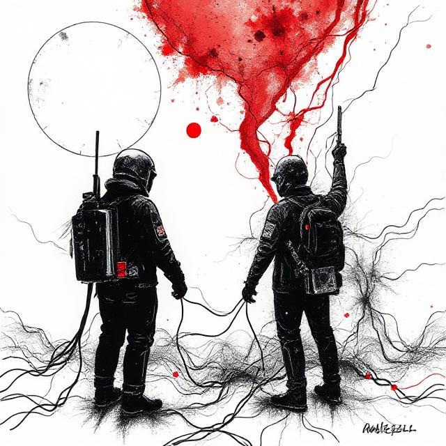

---
# The Positive History and Ethic of Hacker Culture

## Deep Time: Hacking Before It Had a Name

Strip the word "hacker" down to what it actually describes and it has nothing to do with computers: taking a system, using it in a way it wasn't designed for, and making something better — often by breaking it first, and almost always by teaching someone else what you found. That's not a 20th-century American invention. That's a trait as old as human tool use — and it goes back further than our own species.

Neanderthals kept hearths burning across generations and knapped stone tools to exacting, learned specifications — skilled technology that was social as much as material, since none of it survived a single lifetime unless someone taught someone else how to do it. "Hacking," in that sense, isn't a habit modern humans invented. It's closer to a habit that helped make us — and the cousins we evolved alongside — who we are.

Indigenous technologists have practiced this for generations, long before anyone called it hacking. Cultural fire stewardship — the kind practiced by the Karuk and neighboring peoples of this bioregion — is a technology refined and re-refined across centuries, a system worked, observed, and reworked through careful collective knowledge, not handed down from an instruction manual. Scholars like Marisa Elena Duarte have written about Indigenous communities as technologists in their own right, building and rebuilding information networks on their own terms long before "network sovereignty" was a term anyone needed to coin. That's the same creative, iterative, collectively-taught relationship to systems that computer hackers would later bring to mainframes and software — the specific tools changed, the underlying practice didn't.

The rest of this page tells the more recent, better-documented chapter of that story — the one that happens to involve phone lines and computers, because that's the version with a paper trail. It's worth remembering it's a chapter, not the origin.

## The Origins of Modern Hacker Culture

Modern hacker culture, as most people tell the story, took shape alongside personal computing but was rooted in the same curiosity, creativity, and desire to understand and improve complex systems described above. The earliest "hackers" in this telling were not digital criminals, but tinkerers and problem-solvers. In the late 19th century, young telephone operators were known to play pranks by switching lines, demonstrating the first playful exploits of technical systems. By the mid-20th century, the term "hacker" emerged at MIT, not in computer labs, but among students modifying model train sets for fun and challenge. This spirit of exploration soon transferred to mainframe computers, where early hackers at MIT and other institutions developed a culture centered on intellectual curiosity, sharing, and the belief that information should be accessible and improvable by anyone willing to learn.[^1][^2]

## The Original Definition of a Hacker

Originally, a "hacker" was someone who delighted in exploring the limits of what was possible, repurposing technology in creative ways, and sharing their findings with others. Hackers saw technology as a playground for ingenuity, not a weapon for harm. This ethic was rooted in openness, transparency, and the joy of collective problem-solving. The early hacker communities valued cleverness, resourcefulness, and the free exchange of ideas, often working collaboratively to push the boundaries of hardware and software.[^3][^4]

## The Hacker Manifesto

A pivotal moment in hacker culture came in 1986 with the publication of "The Hacker Manifesto" (also known as "The Conscience of a Hacker") by Loyd Blankenship, aka The Mentor. Written after his arrest, the manifesto articulated the mindset of hackers as explorers, not criminals:

> "We explore... and you call us criminals. We seek after knowledge... and you call us criminals. We exist without skin color, without nationality, without religious bias... and you call us criminals. You build atomic bombs, you wage wars, you murder, cheat, and lie to us and try to make us believe it's for our own good, yet we're the criminals."

The manifesto championed the idea that hacking was about curiosity, learning, and the pursuit of knowledge for its own sake-a positive, even utopian, vision of what technology and community could become.[^5]

## Being Called a Criminal Is Not New

The Manifesto's defiance — "Yes, I am a criminal" — sits inside a much older pattern. Every system draws a line around what's legal, and every system's line has, at some point, been wrong. The people willing to work on the wrong side of that line while history catches up aren't always hackers in the technical sense, but they rely on the same thing hackers rely on: protected space to do something the rules don't yet allow.

Privacy is what creates that space. It's tempting to think of privacy as a personal comfort — not wanting a stranger reading your mail — but its deeper job in a free society is letting people organize, experiment, and build alternatives to the status quo before those alternatives are legal, or even popular. The Underground Railroad is the clearest example this country has. Helping someone escape slavery was a crime — after 1850, a federal one, enforceable anywhere in the country. The network survived because it ran on secrecy: coded language, safe houses, routes redrawn constantly, names kept even from allies. That secrecy wasn't incidental to the abolitionists' work. It was the precondition for it.

That's the throughline between hacking, privacy, and democracy that's easy to miss: none of them assume the current rules are the last word. A hacker picking apart a system assumes it could work differently. A democracy that actually listens to its people assumes the law can be wrong, and correctable. Privacy is the room where people get to test that assumption before it's safe to test it in public — for abolitionists, for whistleblowers, for anyone quietly building something the present doesn't yet allow. Protecting that room isn't a loophole in a just society. It's one of the ways a just society stays capable of becoming more just. (If you want the practical side of building that kind of protected space for yourself, our [Privacy 101 guide]() is where to start.)

## The Ethic of the Free Software Movement

The positive hacker ethic found its most enduring expression in the Free Software Movement, formally launched by Richard Stallman in 1983 with the GNU Project. Stallman and his peers believed that software should be free-not just in price, but in freedom: the freedom to run, study, modify, and share it. This philosophy was a direct response to the increasing privatization and secrecy in the software industry, which Stallman saw as a threat to the collaborative, open culture that had defined early computing.

The movement’s foundational document, the GNU Manifesto, argued that proprietary software undermined both technical progress and community. The Free Software Foundation, established in 1985, promoted these ideals and developed legal tools like the GNU General Public License (GPL) and the concept of "copyleft," ensuring that software and its derivatives would always remain free and open.[^6][^7][^8]

## DIY Culture and Collective Empowerment

Hacker culture has always overlapped with the broader Do-It-Yourself (DIY) ethos: the belief that anyone can learn, build, and repair technology themselves. This spirit is evident in everything from early computer clubs and bulletin board systems to modern makerspaces and open-source hardware projects. DIY culture rejects passive consumption in favor of active participation and learning by doing.

At its best, hacker culture is about collective empowerment through shared knowledge. Hackers, free software advocates, and DIYers believe that technology should be a tool for liberation, not control. They champion transparency, accessibility, and the idea that everyone should have the means to shape their own digital destiny. This ethic has inspired generations of programmers, activists, and hobbyists to collaborate on projects that benefit the wider community, from Linux and Wikipedia to Creative Commons and beyond.[^9][^10]

## Conclusion

The positive history of hacker culture is a story of curiosity, openness, and the transformative power of shared knowledge — and it's a much older story than the computer. From fire-keepers before our species had a name for itself, to Indigenous technologists refining systems across generations, to abolitionists organizing in secret because the law left them no legal way to do what was right, to the playful tinkerers of MIT, to the idealists of the Free Software Movement, the throughline is the same: people creatively reworking the tools and rules they're given, and teaching each other what they learn. That's hacker culture at its root, long before anyone needed the word for it.

```

We explore... and you call us criminals.
We seek after knowledge... and you call us criminals.
We exist without skin color, without nationality, without religious bias... and you call us criminals.

You build atomic bombs, you wage wars, you murder, cheat, and lie to us and try to make us believe it's for our own good, yet we're the criminals.

Yes, I am a criminal. My crime is that of curiosity. My crime is that of judging people by what they say and think, not what they look like. My crime is that

```



---

[^1]: [A Brief History of Hacking](https://www.cobalt.io/blog/history-of-hacking)
[^2]: [How Did Hacker Culture Originate?](https://observer.com/2017/08/how-did-hacker-culture-originate-decentralization-history-of-computers/)
[^3]: [Legendary Groups That Shaped Hacker Culture](https://cybernews.com/editorial/legendary-groups-shaped-hacker-culture/)
[^4]: [Cybersecurity: The History of Hacking and Data Breaches](https://www.monroeu.edu/news/cybersecurity-history-hacking-data-breaches)
[^5]: [The Hacker Manifesto (The Mentor)](https://www.mit.edu/~jcb/hacker.html)
[^6]: [Free Software Movement - Wikipedia](https://en.wikipedia.org/wiki/Free_software_movement)
[^7]: [How Did Free Software Build a Social Movement?](https://blog.jwf.io/2020/04/how-did-free-software-build-a-social-movement/)
[^8]: [History of Free and Open-Source Software - Wikipedia](https://en.wikipedia.org/wiki/History_of_free_and_open-source_software)
[^9]: [FOSS Movements, Digital Rebellion (PDF)](https://scholarspace.manoa.hawaii.edu/bitstream/10125/49730/1/FOSS%20Movements,%20Digital%20Rebellion%20final%20draft.pdf)
[^10]: [Free Software Philosophy - Bellevue College](https://www2.bellevuecollege.edu/artshum/materials/phil/Payne/Spring2005/260/FreeSoftwarePhilosophy.htm)
[^11]: [Hacker Spaces](https://hackerspaces.org/)